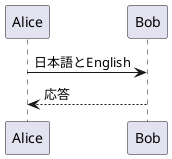

# Neovimのプレビューと整形

## 導入・更新

```bash
cd ~/dotfiles
git pull --ff-only origin codex/ubuntu26.04
bash setup_all.sh --modules neovim,latex,diagrams
```

必要なモジュールを選び、計画を確認して`INSTALL`を入力します。
既存環境でも同じコマンドで、ビューワなど追加の依存パッケージを導入できます。
完了後はNeovimを開き直してください。

PDF・画像のプレビューにはUbuntuのデスクトップ、またはWSLgの表示環境を使います。
Markdownはブラウザに表示し、WSLではWindows側の既定ブラウザを使えます。
WSLのGNOMEテーマ・IME設定は不要です。表示環境のないSSH・サーバーではPDF・画像ビューワは起動できません。
TeX・PlantUMLのコンパイルはローカルで行います。

## TeX

`.tex`ファイルを開き、次を実行します。

```vim
:TexPreview
```

現在のバッファを保存してlatexmkによる継続コンパイルを開始し、生成したPDFをZathuraで表示します。
以後は`:w`で保存するたびに再コンパイルし、PDFビューワが表示を更新します。
表示が変わるのはコンパイル完了後です。TeXにエラーがある場合は`:VimtexErrors`で確認し、修正して保存すると継続コンパイルが再開します。
ZathuraはPDFファイルの変更を監視するため、表示中のPDFを閉じたり手動で再読込したりする必要はありません。

| コマンド | 操作 |
| --- | --- |
| `:TexPreview` | 保存して継続コンパイル・PDF表示を開始 |
| `:TexView` | 生成済みPDFを表示 |
| `:TexPreviewStop` | 継続コンパイルを停止 |
| `:VimtexErrors` | コンパイルのエラー一覧 |
| `:VimtexInfo` | メインファイル・コンパイラーなどの確認 |

標準はpLaTeX＋dvipdfmxです。日本語・英語を含む次のソースを使えます。

```tex
\documentclass{jsarticle}
\begin{document}
日本語とEnglishのプレビュー。
\end{document}
```

LuaLaTeXを使う場合は、メインファイルの先頭でエンジンを指定します。

```tex
% !TeX program = lualatex
\documentclass{ltjsarticle}
\begin{document}
日本語とEnglishのプレビュー。
\end{document}
```

`% !TeX program = uplatex`、`platex`、`pdflatex`も指定できます。
文書クラス・パッケージは指定したエンジンに合わせてください。
プロジェクト固有のビルド設定は、そのプロジェクトの`.latexmkrc`に記述できます。

章ごとにファイルを分けている場合は、子ファイルにメインファイルへの相対パスを記述します。

```tex
% !TeX root = ../main.tex
```

この子ファイルから`:TexPreview`を実行してもメインファイルをコンパイルします。
未保存の他のバッファは自動保存しないため、変更した子ファイルも`:w`で保存してください。

## Markdown

`neovim`モジュールに含まれます。`.md`ファイルを開いて実行します。

```vim
:MarkdownPreview
```

現在のバッファを保存し、ローカルのプレビューページをブラウザで開きます。
日本語・英語の文章、見出し、数式、Mermaid、相対パスの画像を表示できます。
編集中の変更と`:w`で保存した内容を反映するため、ブラウザの再読み込みは不要です。
プレビューを停止するには`:MarkdownPreviewStop`を実行します。

Ubuntuでは既定のブラウザ、WSLではWindows側のブラウザを使います。
WSLからWindowsのブラウザで開く場合は、WSLのlocalhost転送が有効である必要があります。

## PlantUML

`.puml`ファイルを開いて実行します。

```vim
:PlantumlPreview
```

現在のバッファを保存してPNGを生成し、fehで表示します。
以後は`:w`で保存すると再生成され、ビューワが自動で再表示します。
停止するには`:PlantumlStop`を実行します。



構文エラーの場合はNeovimに通知し、直前に生成できたプレビューを保持します。
相対パスの`!include`はソースファイルのディレクトリを基準に解決します。
読み込む別ファイルだけを変更した場合は、プレビュー中のメイン`.puml`も`:w`で保存するか、`:PlantumlPreview`を再実行してください。

## ファイル種別に応じた整形

編集中のバッファで実行します。

```vim
:Format
```

| ファイル | 整形方法 |
| --- | --- |
| C/C++ | `clang_autoformat`と同じROS 2 Lyrical用`ament_uncrustify` |
| Python | `pep8_autoformat`と同じautopep8設定 |
| その他 | 接続中のLSPが提供する整形機能 |

未保存の編集内容も整形します。結果を確認し、`:w`で保存してください。`u`で整形を取り消せます。
C/C++のROS整形には`ros2`モジュールが必要です。通常はシェル起動時にLyricalを読み込みます。
見つからない場合は`ros_env`を実行した端末からNeovimを起動してください。

`:RosFormat`はC/C++・Python用の同じ処理です。
プロジェクト独自の`.clang-format`を使いたい場合は`:ClangFormat`を実行します。
整形できるLSPが接続されていない場合は案内を表示します。`:DotfilesLsp`で状態を確認できます。

整形と規約違反の診断は別の機能です。ROSの命名・docstringなどの検査は[ROS 2コード整形](ros-formatting.md)を参照してください。

## 参照

- [VimTeX](https://github.com/lervag/vimtex)
- [latexmk](https://ctan.org/pkg/latexmk)
- [Zathura](https://pwmt.org/projects/zathura/)
- [live-preview.nvim](https://github.com/brianhuster/live-preview.nvim)
- [PlantUMLのコマンドライン](https://plantuml.com/command-line)
- [fehのマニュアル](https://man.finalrewind.org/1/feh/)
